# Lab6Web:JavaScript DOM dan Event Handling
# Identitas Praktikum
- Mata kuliah: Pemrograman Web
- Pertemuan: 7
- Topik: JavaScript DOM dan Event Handling
- Nama: Alfi Iftihal Nurul Afiat
- NIM: 312510041
- Kelas: I251D
- Repository: Lab6Web
# 1. Tujuan Praktikum
1. Memahami DOM sebagai representasi dokumen HTML yang dapat diakses
   dan dimanipulasi JavaScript.
2. Menggunakan ID dan selector untuk memilih elemen HTML.
3. Mengubah teks, kelas CSS, dan tampilan elemen melalui JavaScript.
4. Menangani interaksi pengguna menggunakan ````addEventListener()````.
5. Membuat validasi form dan menampilkan pesan sesuai kondisi input.
6. Membuat halaman interaktif yang memiliki beberapa fungsi.
# 2. Struktur Folder
````
Lab6Web/
├── index.html
├── style.css
├── script.js
├── README.md
└── ss/
````
# 3. Cara Menjalankan
1. Buka folder ````Lab6Web```` di Visual Studio Code.
2. Pastikan ````index.html````, ````style.css````, dan ````script.js```` berada dalam
   folder yang sama.
3. Pastikan HTML menghubungkan CSS dengan
   ````<link rel="stylesheet" href="style.css">````.
4. Untuk versi akhir, pastikan script menggunakan
   ````<script src="script.js" defer></script>````.
5. Buka ````index.html```` di browser.
6. Untuk melihat error, buka Developer Tools dengan ````F12```` dan pilih tab
   Console.
# 4. Langkah Kerja dan Output
## Latihan 1 --- Mengubah teks dengan DOM
**Langkah:** Memilih elemen ````judul```` dan ````pesan```` menggunakan
````getElementById()````, kemudian mengubah teks memakai ````textContent````.

**Output yang diharapkan:** Judul berubah menjadi "Belajar JavaScript
DOM" dan paragraf menjadi "Konten berhasil diubah oleh JavaScript."
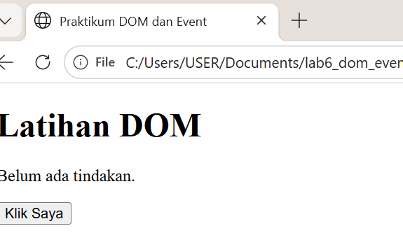 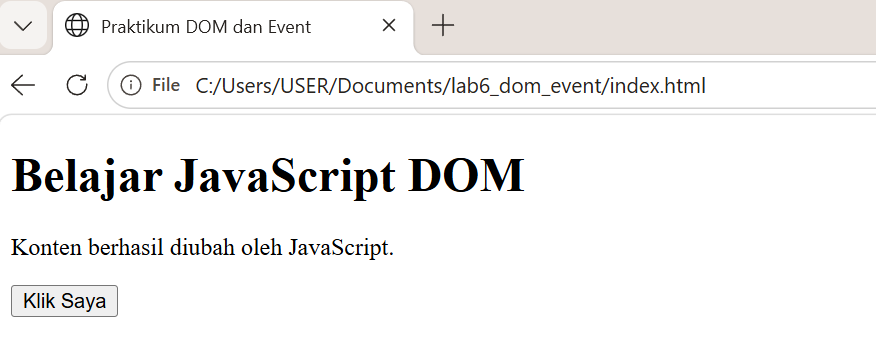
## Latihan 2 --- Event click
**Langkah:** Menambahkan event listener ````click```` pada tombol
````tombolAksi````. Saat tombol ditekan, program menampilkan waktu saat ini.

**Output yang diharapkan:** Paragraf menampilkan pesan seperti "Tombol
diklik pada 16.14.20". Waktu aktual mengikuti komputer.
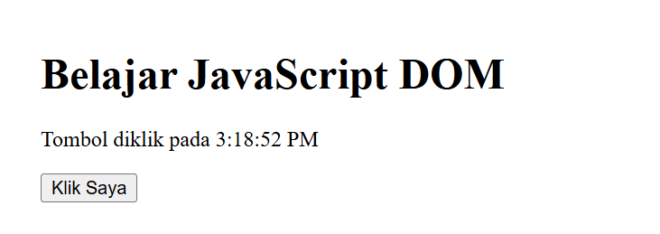
## Latihan 3 --- Mengubah kelas dan gaya CSS
**Langkah:** Membuat kelas CSS ````highlight```` dan ````teks-besar````, lalu
mengaktifkan atau menonaktifkannya dengan ````classList.toggle()````.

**Output yang diharapkan:** Klik pertama memberi warna teks, latar,
garis tepi, dan ukuran font yang berbeda. Klik kedua mengembalikan
tampilan awal.
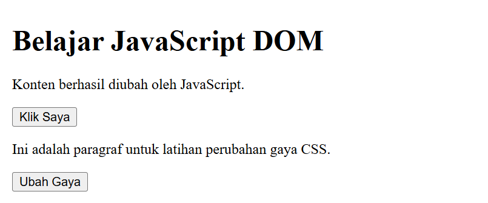 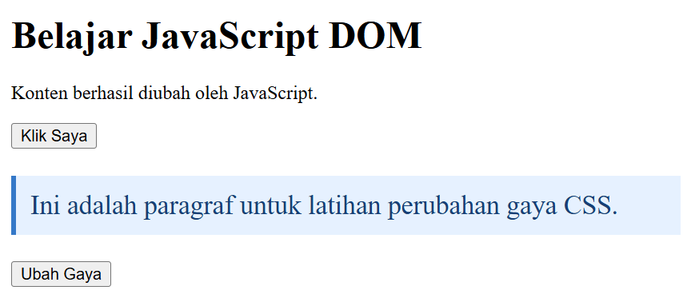
## Latihan 4 --- Penghitung karakter
**Langkah:** Memakai event ````input```` dan properti ````value.length````.

**Output yang diharapkan:** - ````Alfi```` menghasilkan 4 karakter. -
````Alfi Iftihal```` menghasilkan 12 karakter termasuk spasi. - Input kosong
menghasilkan 0 karakter.
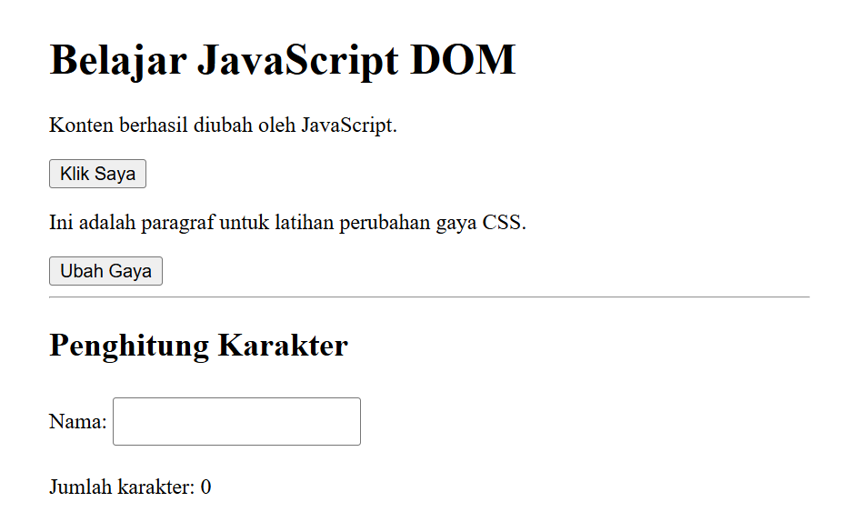 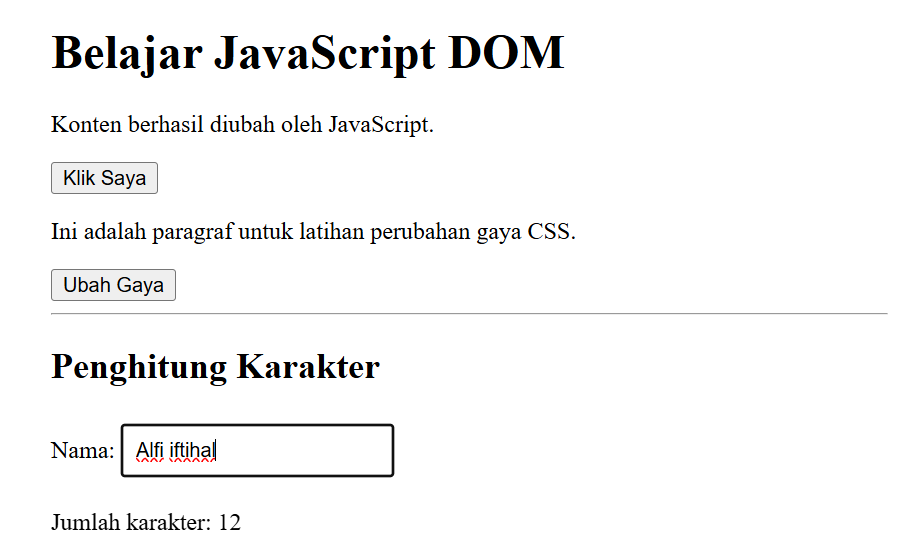
## Latihan 5 --- Validasi form pendaftaran
**Langkah:** Memeriksa nama, format email, dan usia menggunakan event
````submit````, ````preventDefault()````, dan kondisi ````if/else````.

**Output yang diharapkan:** 1. Semua kosong: ````Nama wajib diisi````. 2. Nama
kosong dengan email dan usia terisi: ````Nama wajib diisi````. 3. Email tidak
valid: ````Masukkan email yang valid````. 4. Usia 16:
````Usia harus berupa bilangan bulat 17–100````. 5. Data valid, misalnya Budi,
````budi@gmail.com````, usia 20: ````Validasi berhasil. Form siap diproses````.
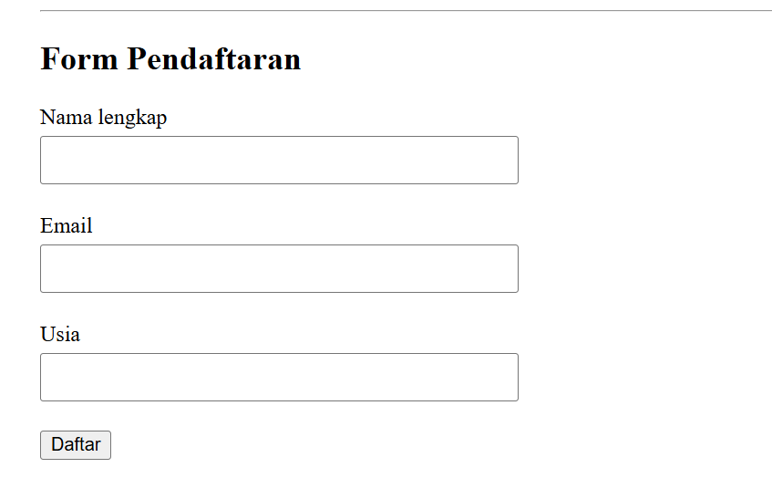 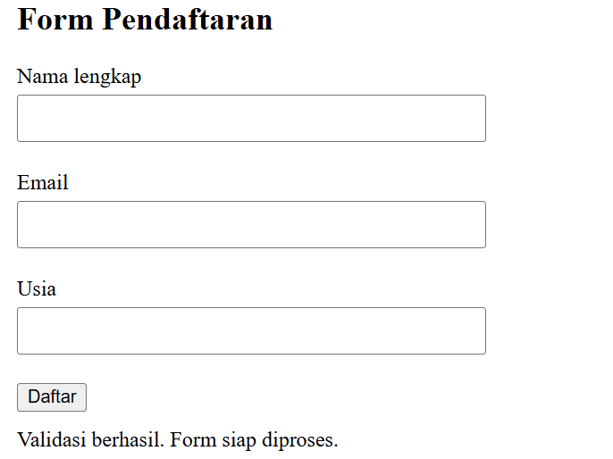
## Latihan 6 --- To-do List
**Langkah:** Menambahkan tugas menggunakan ````createElement()````,
````appendChild()````, dan event listener. Tombol selesai mengubah kelas
````selesai````.

**Output yang diharapkan:** Input kosong menampilkan
````Tulis tugas terlebih dahulu````.. Tugas yang ditambahkan muncul dalam
daftar. Klik "Tandai selesai" mencoret teks tugas.
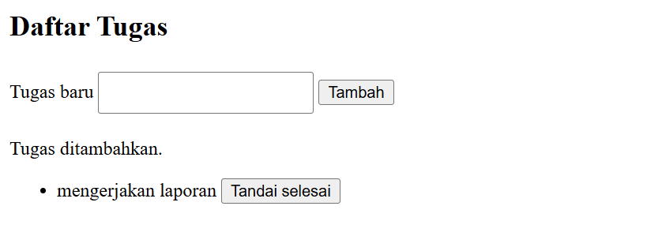 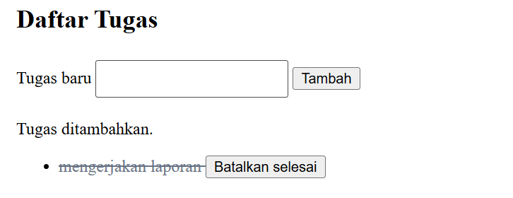
# 5. Mini Project --- Form Pendaftaran Workshop
Mini project berisi input nama, email, pilihan sesi, penghitung
karakter, ringkasan input, pesan validasi, dan tombol reset.

**Pengujian dan output yang diharapkan:** 1. Semua kolom kosong:
````Nama lengkap wajib diisi````. 2. Email tidak valid:
````Masukkan alamat email yang valid````. 3. Sesi belum dipilih:
````Silakan pilih sesi workshop````. 4. Semua data valid:
````Pendaftaran berhasil. Terima kasih, [nama]!```` 5. Mengetik nama
memperbarui penghitung karakter. 6. Mengubah dropdown memperbarui teks
sesi terpilih. 7. Tombol Reset mengosongkan input dan pesan.
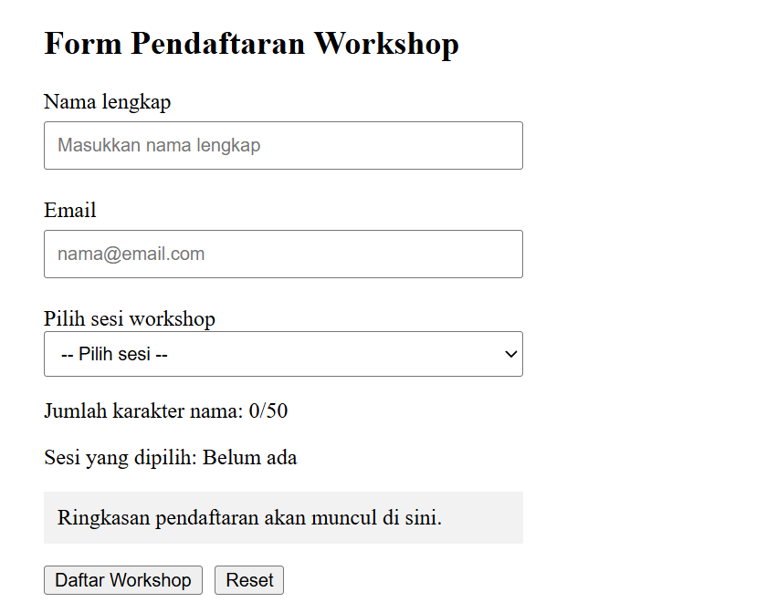 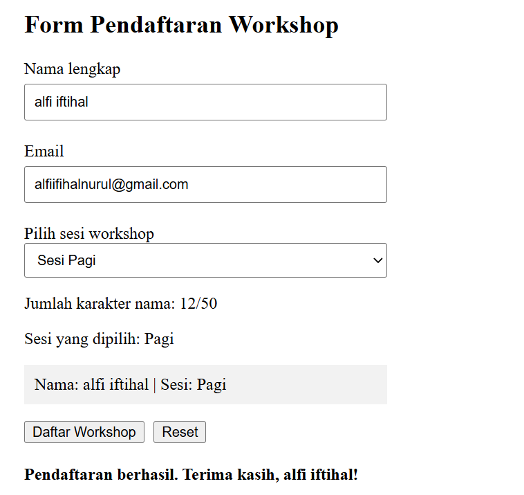
# 6. Eksperimen Mandiri
## Eksperimen 1 --- Menghapus satu tugas
**Perubahan:** Menambahkan tombol Hapus di setiap item dan memakai
````item.remove()````.

**Output:** Item yang dipilih hilang, item lain tetap tampil.
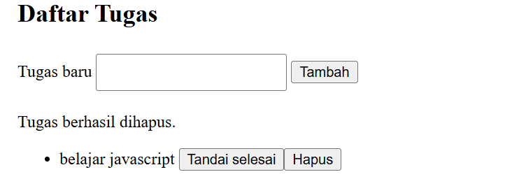
## Eksperimen 2 --- Nama minimal tiga karakter
**Perubahan:** Menambahkan kondisi nama.length < 3.

**Output:** Nama ````Al```` ditolak dengan pesan
````Nama minimal terdiri dari 3 karakter.````. Nama ````Ali```` lolos pemeriksaan
panjang nama, dengan syarat email dan sesi valid.
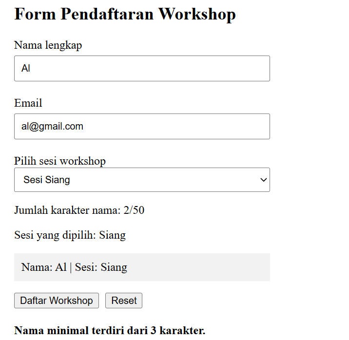 
## Eksperimen 3 --- Event change pada dropdown
**Perubahan:** Memasang event ````change```` pada dropdown sesi.

**Output:** Teks sesi terpilih berubah sesuai pilihan Pagi, Siang, atau
Sore.
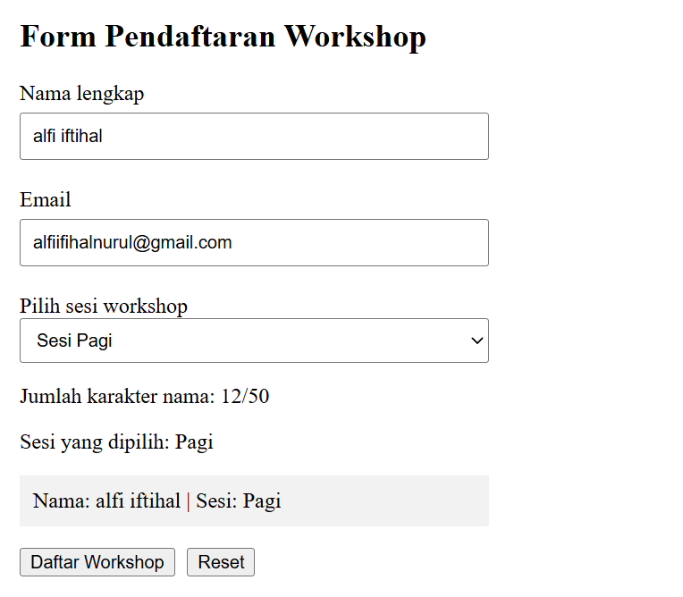
## Eksperimen 4 --- Menyembunyikan dan menampilkan paragraf
**Perubahan:** Membuat kelas ````.sembunyi { display: none; }```` dan
menggunakan ````classList.toggle().````

**Output:** Tombol menyembunyikan paragraf dan dapat menampilkannya
kembali.
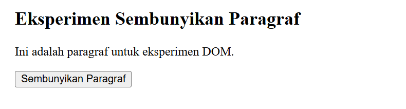 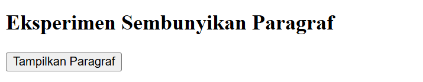
## Eksperimen 5 --- Script tanpa defer
**Perubahan:** Menghapus ````defer```` dari script di bagian ````head```` untuk
pengujian, lalu mengembalikannya setelah pengamatan.

**Output yang mungkin:** JavaScript dapat dijalankan sebelum elemen HTML
selesai diparsing. Pemilihan elemen bisa menghasilkan ````null```` dan
menyebabkan error. Catat hasil aktual dari Console, karena error tidak
selalu muncul dengan bentuk yang sama.
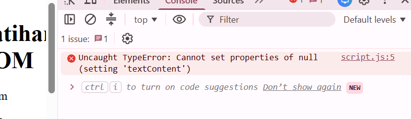

# 7. Jawaban Pertanyaan Evaluasi
**1. Apa yang dimaksud dengan DOM dan apa manfaatnya?**
DOM (Document Object Model) adalah representasi dokumen HTML dalam
bentuk objek yang dapat diakses dan dimanipulasi JavaScript. DOM
bermanfaat untuk memilih elemen, mengubah teks, mengubah atribut dan
kelas CSS, serta merespons tindakan pengguna.
**2. Apa perbedaan ````getElementById()````, ````querySelector()````, dan ````querySelectorAll()````?**
- ````getElementById()```` memilih elemen berdasarkan nilai ID.
- ````querySelector()```` memilih elemen pertama yang cocok dengan selector
  CSS.
- ````querySelectorAll()```` memilih semua elemen yang cocok dengan selector
  CSS.
**3. Apa fungsi ````addEventListener()```` dan sebutkan tiga contoh event?**
````addEventListener()```` menghubungkan suatu event dengan fungsi yang
dijalankan ketika event terjadi. Contoh event: ````click````, ````input````, dan
````submit````. Contoh lainnya adalah ````change````, ````keydown````, dan ````mouseover````.
**4. Mengapa ````event.preventDefault()```` digunakan pada event submit form?**
````event.preventDefault()```` mencegah perilaku bawaan form, seperti
pengiriman yang menyebabkan halaman dimuat ulang. Dengan begitu,
JavaScript dapat memeriksa input dan menampilkan pesan validasi terlebih
dahulu.
**5. Apa perbedaan ````textContent```` dan ````innerHTML```` dari sisi penggunaan dan keamanan?**
````textContent```` membaca atau mengubah teks biasa pada elemen. ````innerHTML````
membaca atau mengubah konten HTML termasuk markup. Untuk menampilkan
teks dari pengguna, ````textContent```` lebih aman karena tidak menafsirkan
input sebagai markup HTML. Memasukkan input yang tidak dipercaya ke
````innerHTML```` dapat menimbulkan risiko keamanan.
**6. Bagaimana ````classList.toggle()```` membantu mengubah tampilan elemen?**
````classList.toggle()```` menambahkan kelas jika kelas tersebut belum ada dan
menghapusnya jika sudah ada. Dengan demikian, JavaScript dapat
mengaktifkan atau menonaktifkan gaya CSS secara bergantian, misalnya
untuk menyorot teks atau menyembunyikan paragraf.
**7. Sebutkan minimal tiga skenario pengujian validasi form.**
1. Semua input kosong. Program harus menampilkan pesan bahwa nama wajib
   diisi.
2. Email tidak valid. Program harus meminta pengguna memasukkan email
   yang valid.
3. Usia di bawah 17 tahun. Program harus menolak usia tersebut.
4. Semua input valid. Program harus menampilkan pesan validasi
   berhasil.
5. Pada mini project, sesi workshop yang belum dipilih juga harus
   ditolak.
# 8. Kesimpulan
Praktikum ini menerapkan pemilihan dan manipulasi DOM, event handling,
perubahan kelas CSS, penghitung karakter, validasi form, dan pembuatan
daftar tugas dinamis. Mini project menggabungkan fitur validasi,
ringkasan input, pilihan sesi, dan reset. Hasil akhir harus diverifikasi
melalui pengujian browser dan didukung screenshot yang benar-benar
diambil selama praktikum.
